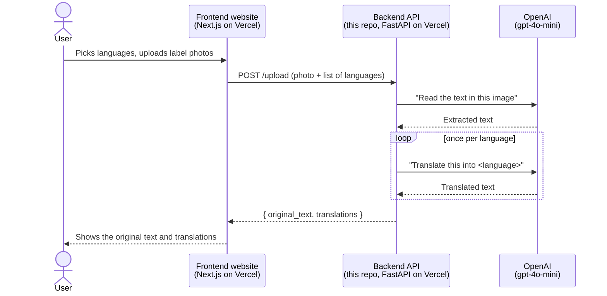

# HackIt-Rx — Backend (Medicine Label Translator API)

This is the **backend** (server side) of a hackathon project that helps pharmacists, patients and caregivers understand medicine labels in their own language.

The app works like this:

1. Someone takes or uploads a photo of a medicine label or prescription.
2. The backend uses AI to **read the text** in the photo. This step is called OCR (Optical Character Recognition).
3. The backend then uses AI to **translate** that text into up to 3 languages.
4. The translations go back to the website, which shows them to the user.

The website that people actually use lives in a separate repository, **[HackIt-Rx_FrontEnd](https://github.com/bharathan03/HackIt-Rx_FrontEnd)**. This repository holds only the "brain" that does the reading and translating.

---

## Table of contents

- [How the frontend and backend fit together](#how-the-frontend-and-backend-fit-together)
- [Tech used (and what each thing is)](#tech-used-and-what-each-thing-is)
- [Folder structure: what every file does](#folder-structure-what-every-file-does)
- [The API endpoints](#the-api-endpoints)
- [Running it on your own computer](#running-it-on-your-own-computer)
- [How it's deployed (Vercel)](#how-its-deployed-vercel)
- [Known quirks and leftover code](#known-quirks-and-leftover-code)

---

## How the frontend and backend fit together



In plain words:

- The **frontend** is the part you see: buttons, pages and photo upload. It runs in the user's browser.
- The **backend** (this repo) is a small web server. It receives the photo, talks to OpenAI, and sends back the results as JSON, a simple text format that programs use to pass data to each other.
- **OpenAI** does the actual AI work. The backend is basically a messenger between the website and OpenAI, and it keeps the secret OpenAI API key hidden from the public.

> **Why not call OpenAI directly from the website?** The OpenAI API key is like a password tied to a credit card. Anything in frontend code can be seen by anyone who visits the site. Keeping the key on a backend server keeps it private.

---

## Tech used (and what each thing is)

| Tool | What it is | Why it's here |
|---|---|---|
| **Python** | The programming language the backend is written in. | — |
| **[FastAPI](https://fastapi.tiangolo.com/)** | A Python library for building web APIs quickly. | Defines the URLs (endpoints) the frontend can call. |
| **[Uvicorn](https://www.uvicorn.org/)** | A web server that runs FastAPI apps. | Needed to run the backend on your own computer. |
| **[OpenAI Python SDK](https://github.com/openai/openai-python)** | The official library for talking to OpenAI. | Sends the image and text to the `gpt-4o-mini` model. |
| **python-multipart** | A helper that lets FastAPI read uploaded files and form fields. | The photo arrives as a file upload. |
| **python-dotenv** | Loads settings from a `.env` file. | Lets you store `OPENAI_API_KEY` locally without hard-coding it. |
| **Pillow** | A Python image library. | Only used by the unused OCR fallback (see [quirks](#known-quirks-and-leftover-code)). |
| **[Vercel](https://vercel.com/)** | A hosting service. | Runs the backend on the internet ("production"). |

---

## Folder structure: what every file does

```
HackIt-Rx/
├── README.md                  ← you are here
└── backend/
    ├── main.py                ← the web server: all the URLs/endpoints live here
    ├── requirements.txt       ← list of Python libraries to install
    ├── vercel.json            ← instructions telling Vercel how to run this on the internet
    ├── .gitignore             ← files Git should NOT upload (secrets, virtual env)
    └── services/
        ├── __init__.py        ← empty file; tells Python "this folder is a package"
        ├── openai_service.py  ← the code that actually talks to OpenAI
        └── ocr_fallback.py    ← backup OCR using Tesseract (NOT currently used)
```

(You may also see `__pycache__/` folders. Python creates these automatically to speed things up. You can ignore them.)

### `backend/main.py` — the web server

This is the entry point of the backend. Here's what it does, from top to bottom:

1. **`load_dotenv()`** reads a `.env` file (if there is one) so `OPENAI_API_KEY` becomes available.
2. **`app = FastAPI()`** creates the web application.
3. **CORS setup (`CORSMiddleware`).** Browsers normally block a website on one domain (the frontend) from calling a server on a different domain (the backend). This security rule is called **CORS**. This block tells the browser that these websites are allowed to call the backend:
   - `https://hack-it-rx-front-end.vercel.app` (the live frontend)
   - any Vercel preview URL starting with `hack-it-rx-front-end` (matched by `allow_origin_regex`)
   - `http://localhost:3000` (the frontend running on your own computer)
4. **`preflight_handler`.** Before some requests, browsers first send a check request called an `OPTIONS` "preflight". This catch-all makes sure those checks always get an OK. It was added to fix CORS problems when running on Vercel.
5. **The endpoints (routes):** `/`, `/upload`, `/session/extract`, `/image/{filename}`, `/health` and `/translate`. See [The API endpoints](#the-api-endpoints) below.

The endpoint that really matters is **`/upload`**. It's the only one the frontend actually calls.

### `backend/services/openai_service.py` — the AI part

This file has three functions:

- **`get_client()`** reads `OPENAI_API_KEY` from the environment and creates an OpenAI client. **If there's no key, it returns `None`.**
- **`extract_text_from_image(file_path)`** is the OCR step:
  1. It opens the saved image and converts it to **base64**, a way of turning a binary image file into plain text so it can be sent inside a JSON message.
  2. It sends the image to `gpt-4o-mini` (a model that can "see" images) with the instruction *"Extract the text clearly from this prescription image."*
  3. It returns the text the model found.
- **`translate_text(text, target_language)`** asks `gpt-4o-mini` to *"Translate this medical prescription into {target_language}"* and returns the result.

**Mock mode:** if `OPENAI_API_KEY` is not set, both functions return fake placeholder text such as `MOCKED_OCR_RESULT: Take 1 tablet daily after meals.` instead of calling OpenAI. This lets you test the whole app for free without an API key. If you see "MOCKED" in the results, the key isn't configured.

### `backend/services/ocr_fallback.py` — unused backup

This was meant to be a backup OCR that runs locally with [Tesseract](https://github.com/tesseract-ocr/tesseract) in case OpenAI failed. It is **not called anywhere**, and `pytesseract` was removed from `requirements.txt` (commit `473d296`). It's safe to ignore or delete.

### `backend/services/__init__.py`

This empty file tells Python that `services/` is a package. Without it, `from services.openai_service import ...` in `main.py` could fail.

### `backend/requirements.txt`

This is the shopping list of Python libraries. Running `pip install -r requirements.txt` installs all of them. Vercel reads this file automatically when it deploys.

### `backend/vercel.json`

This file tells Vercel how to host the backend:

- `"builds"`: "`main.py` is a Python app, so use Vercel's Python runtime (`@vercel/python`) to run it."
- `"rewrites"`: "Send **every** URL (`/(.*)`) to `main.py`." FastAPI then decides which endpoint handles it.
- `"headers"`: adds CORS headers at the Vercel level too. This is a belt-and-braces addition from debugging CORS during the hackathon.

### `backend/.gitignore`

This file lists things Git should never upload:

- `.env`: holds your secret API key. **Never commit this.**
- `.venv/`: your local Python virtual environment, which is large and machine-specific.
- `app.py`: an old version of the server that was replaced by `main.py`.

---

## The API endpoints

An **endpoint** is a URL on the server that does one specific job. Once the server is running, FastAPI also gives you an interactive page at **`/docs`** where you can try every endpoint in your browser.

| Method | URL | Used by frontend? | What it does |
|---|---|---|---|
| `GET` | `/` | No | Returns `{"status": "ok"}`. A simple "is it alive?" check. |
| `GET` | `/health` | No | Same as above. |
| **`POST`** | **`/upload`** | **Yes ✅** | **Main feature.** Takes a photo and a list of languages, then returns the extracted text and translations. |
| `POST` | `/translate` | No | An older version of `/upload` that takes up to 3 languages as separate fields (`lang1`, `lang2`, `lang3`). |
| `POST` | `/session/extract` | No | An unfinished "session" idea. See [quirks](#known-quirks-and-leftover-code). |
| `GET` | `/image/{filename}` | No | Meant to return a saved image, but images are never saved to that folder. |

### `POST /upload` in detail

**Request.** This is sent as `multipart/form-data`, the same format a normal HTML file-upload form uses:

| Field | Type | Example |
|---|---|---|
| `image` | file | a `.jpg` or `.png` photo of the label |
| `languages` | text containing a JSON list | `["English", "Spanish", "Hindi"]` |

> Note: the frontend sends **language names** like `"Spanish"`, not codes like `"es"`. The name goes straight into the OpenAI prompt ("Translate this … into Spanish").

**What happens inside:**

1. The server turns the `languages` text into a Python list. If that fails, it returns a `400` error.
2. It saves the uploaded image to a temporary file.
3. It calls `extract_text_from_image()` to read the text. If that fails, it returns a `500` error.
4. It calls `translate_text()` once for each language.
5. It returns the results.

**Response (JSON):**

```json
{
  "original_text": "Amoxicillin 500mg. Take 1 capsule three times daily...",
  "translations": {
    "English": "Amoxicillin 500mg. Take 1 capsule three times daily...",
    "Spanish": "Amoxicilina 500 mg. Tome 1 cápsula tres veces al día...",
    "Hindi": "..."
  }
}
```

**Try it from the command line** (with the server running locally):

```bash
curl -X POST http://localhost:8080/upload \
  -F "image=@label.jpg" \
  -F 'languages=["English","Spanish"]'
```

---

## Running it on your own computer

### 1. Install Python

You need Python **3.10 or newer**, because the code uses the `list[str]` syntax. Check your version with:

```bash
python --version
```

### 2. Create a virtual environment and install the libraries

A **virtual environment** is a private folder of libraries just for this project, so it doesn't clash with other Python projects on your computer.

```bash
cd backend
python -m venv .venv

# Activate it:
# Windows (PowerShell):
.venv\Scripts\Activate.ps1
# macOS / Linux:
source .venv/bin/activate

pip install -r requirements.txt
```

### 3. (Optional) Add your OpenAI API key

Create a file called `backend/.env` containing:

```
OPENAI_API_KEY=sk-your-key-here
```

If you skip this step, the server still works but returns **mock** (fake) results. This is handy for testing without spending money.

### 4. Start the server

```bash
uvicorn main:app --reload --port 8080
```

- `main:app` means "in the file `main.py`, find the variable called `app`."
- `--reload` restarts the server automatically when you edit code.
- `--port 8080` matters because the frontend expects the backend at `http://localhost:8080` by default.

Now open **http://localhost:8080/docs** in your browser to see and test the API.

### 5. Run the frontend too

Follow the README in the [HackIt-Rx_FrontEnd](https://github.com/bharathan03/HackIt-Rx_FrontEnd) repo. It will run at `http://localhost:3000` and talk to this backend at `http://localhost:8080`.

---

## How it's deployed (Vercel)

Both halves of the project are hosted on **Vercel** as **two separate Vercel projects**:

| Part | Repo | Who visits it |
|---|---|---|
| Frontend | `HackIt-Rx_FrontEnd` | Users, at https://hack-it-rx-front-end.vercel.app |
| Backend | `HackIt-Rx` (this one) | Only the frontend. Users never open the backend's URL directly. |

How the backend deployment works:

1. The Vercel project is connected to this GitHub repo. Every push to `main` triggers a new deployment.
2. Because `vercel.json` sits inside `backend/`, the Vercel project's **Root Directory** setting should be `backend`.
3. Vercel reads `vercel.json`, installs `requirements.txt` and runs `main.py` as a **serverless function**. This means there's no always-on server; Vercel starts the code on demand whenever a request comes in.
4. The **`OPENAI_API_KEY` environment variable** must be set in the Vercel project settings (Settings → Environment Variables). Without it, production returns mock results.

**Connecting the two:** the frontend finds the backend through its `NEXT_PUBLIC_API_URL` environment variable, which is set in the *frontend's* Vercel project to this backend's URL. If the frontend's domain ever changes, you'll need to update the CORS `origins` list in `main.py` (and the headers in `vercel.json`) or the browser will block the requests.

---

## Known quirks and leftover code

This was built quickly at a hackathon, so a few things are unfinished. None of them break the main `/upload` flow, but they're worth knowing about:

- **`/session/extract` doesn't work.** `SESSIONS` is always empty, because nothing ever adds to it, so the endpoint always returns an empty list. It also calls `translate_text()` without `await`, which would return an unfinished "coroutine" object instead of text.
- **`/image/{filename}` never finds anything.** It looks in an `uploads/` folder, but no code saves images there.
- **`/translate` duplicates `/upload`** and isn't used by the frontend. It also saves files as `temp_<filename>` in the current folder, which is read-only on Vercel.
- **Temporary files aren't deleted.** `/upload` creates a temp file with `delete=False` and never removes it. That's fine on serverless Vercel, but it would slowly fill up disk space on a normal server.
- **`ocr_fallback.py` isn't wired up** and its `pytesseract` dependency isn't installed.
- **The docstring for `/translate`** says it "fallbacks to pytesseract", but that's no longer true.
- **`__pycache__/` folders are committed to Git.** They're auto-generated and could be added to `.gitignore`.
- **The OpenAI calls are synchronous inside `async` functions.** This works, but multiple translations run one after another rather than at the same time, so uploads with 3 languages are slower.
